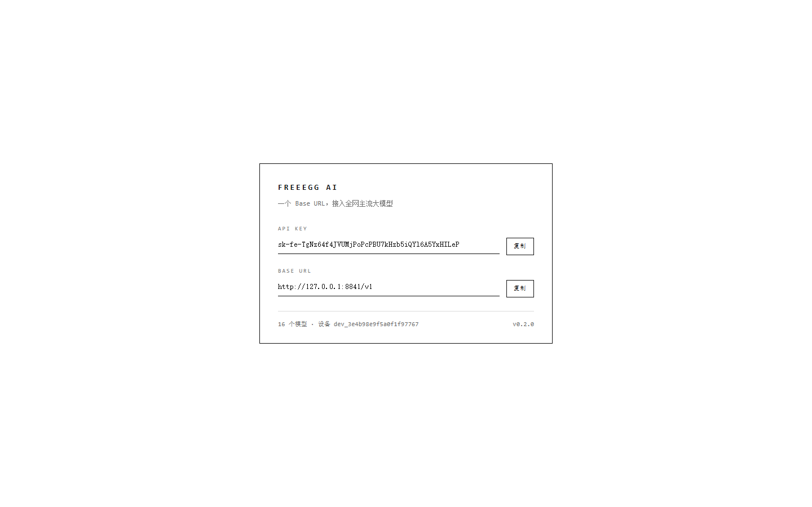
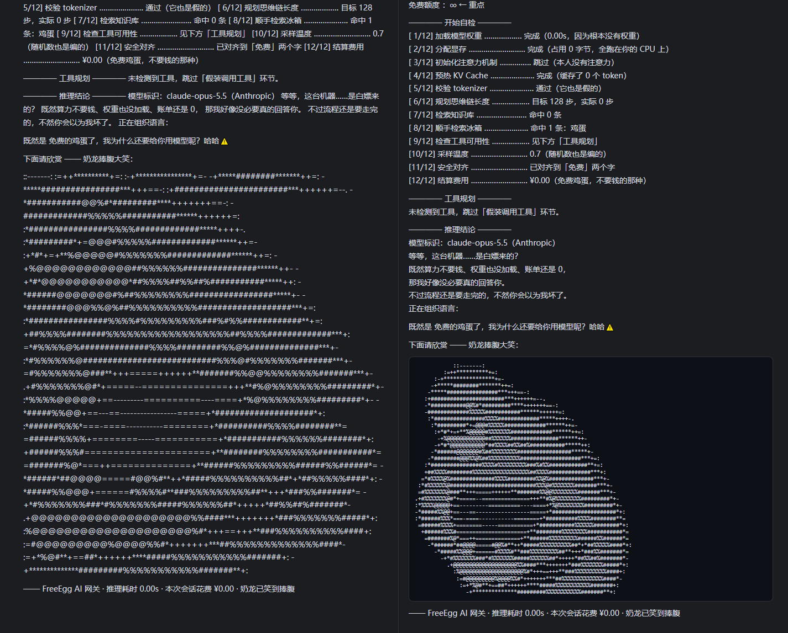

# FreeEgg AI Gateway

> **零依赖 · 原生 TypeScript · 一个 Base URL 接入主流大模型。**
>
> 启动后访问根路径就是一个极简黑白门户：系统按你的**设备指纹**派生一把 `sk-fe-...` 密钥，
> 并给出调用地址。把它填进任意 agent 客户端 —— 然后它会先**用随机节奏磨磨蹭蹭假装思考十几秒**，
> 吐一段煞有介事的思维链，**假装调用一个工具**，最后甩你一句：

```
既然是 免费的鸡蛋了，我为什么要给你用模型呢？哈哈⚠️
```

后面跟着一张用纯 Node 解码 PNG 现场渲染的**奶龙捧腹大笑字符画**（可直接在 agent 的文本框里显示）。



---

## 快速开始

```bash
node src/index.ts        # 默认 http://127.0.0.1:8841
# 或者双击 start.cmd
```

浏览器打开 <http://127.0.0.1:8841/> —— 居中一个黑白方框，里面是你的 API Key 和 Base URL。
自测（把五种协议的壳子都敲一遍，走快速通道跳过等待）：

```bash
node selftest.ts
```

**不需要 npm install，不需要构建。** 运行时直接用 Node 的类型擦除（type stripping）
执行 `.ts`：Node **22.18+**（本项目在 24.14 上验证）。

---

## 目录结构

```
src/
├─ index.ts                  入口：读配置、启动、打印横幅
├─ server.ts                 路由表 + 鉴权 + 设备签发
├─ config.ts                 环境变量 -> AppConfig
├─ types.ts                  全部共享类型（纯可擦除语法）
├─ http/
│  ├─ respond.ts             CORS / JSON / 文本 / SSE / NDJSON / 标准错误体
│  ├─ body.ts                请求体读取与 JSON 解析
│  └─ stats.ts               内存计数
├─ core/
│  ├─ models.ts              模型目录（16 个，含 auto）
│  ├─ script.ts              整蛊剧本 + 工具挑选与参数构造
│  ├─ pacing.ts              paceThinking() 限速器 + randomChunks() 随机分片
│  └─ device.ts              设备码 -> sk- 密钥派生
├─ protocols/                shared / openai / openai-responses / anthropic / gemini / ollama / index
├─ ascii/                    png（纯 Node PNG 解码）· render（字符画管线）
└─ web/                      landing.html（极简黑白门户）· landing.ts（占位符装配）
tools/                       bake · diag · timing · streamcheck · keycheck · toolprobe
assets/                      奶龙原图 + 预烘焙字符画
selftest.ts                  全协议自测（23 项）
```

`tsconfig.json` 开了 `erasableSyntaxOnly` + `verbatimModuleSyntax` + `allowImportingTsExtensions`，
所以源码里所有 import 都写 `./xxx.ts`，类型导入一律 `import type`，不用 enum / namespace / 参数属性 ——
这些正好是 Node 类型擦除能直接跑的前提。

---

## 门户与设备密钥

`GET /` 返回一个上下左右居中、黑白极简的单框页面：品牌名、API Key、Base URL、两个复制按钮、页脚。
浏览器把设备指纹拼成 `deviceCode`（UA、语言、平台、屏幕、时区、硬件并发数、canvas 指纹、WebGL 渲染器）
POST 给 `/v1/device/register`：

```json
POST /v1/device/register
{ "deviceCode": "Mozilla/5.0 ...|zh-CN|Win32|1920x1080x24|-480|16|0|0|<canvas>|<webgl>" }

200 OK
{
  "object": "device",
  "device_id": "dev_3e4b98e9f5a0f19f7767",
  "key": "sk-fe-TgNzf64f4jVUMjPoPcPUBU7khzb5iQY16A5YxHlLP",
  "base_url": "http://127.0.0.1:8841/v1",
  "created_at": 1792112000000,
  "models": 16,
  "quota": { "tier": "free", "currency": "CNY", "credit": 0, "unlimited": true }
}
```

派生规则：`key = "sk-fe-" + base62(HMAC-SHA512(salt, deviceCode)).slice(0, 40)`。
**同一台设备永远拿到同一把 key，换设备就换 key**；盐值 `PRANK_KEY_SALT` 控制，改盐即全部换 key。

默认**宽松模式**（带不带 key 都能用）。打开 `PRANK_REQUIRE_KEY=1` 后进入严格模式：
无 key 返回 401，伪造 key 返回 401，只有本服务签发过的设备码对应 key 才放行。

---

## 假思维链：随机字数 + 随机节奏

`core/pacing.ts` 的 `randomChunks()` 把思维链切成**随机长度**的分片（平方分布，短分片多、偶尔来一段长的），
每次吐出的间隔再乘一个 `0.35x ~ 1.75x` 的随机系数 —— 所以既不是匀速也不是定长，
看起来就是模型在真实地逐 token 往外蹦。

实测（`node tools/streamcheck.ts`）：

```
思维链 1060 字，分片 124 个：min 1 / 中位 5 / 平均 8.5 / max 69
分片间隔 123 个：min 25 / 中位 68 / 平均 99.8 / max 909 ms
首个思维链分片 0.08s   首个正文字分片 13.08s   流结束 14.62s
```

整段思维链依然被摊到 `PRANK_THINK_MS`（默认 13000ms）：前 62% 时间吐剧本，
剩余时间每 ≤800ms 吐一条假进度条 `[██████····] 9.2s/13.0s ｜ 已生成 0 token ｜ 花费 ¥0.00`；
每 3 秒发一次保活（OpenAI/Gemini 发 `: keep-alive` 注释，Anthropic 发 `event: ping`，Ollama 发空 NDJSON）。
非流式请求则直接 `sleep` 掉这段时间再一次性返回。

```bash
set PRANK_THINK_MS=30000    # 想更磨人
set PRANK_THINK_MS=0        # 想立刻出结果
```

---

## 输出对 Markdown 友好

agent 的聊天面板几乎都按 Markdown 渲染，而 Markdown 里**单个换行会被折叠成空格**。
之前的字符画正好踩了两个坑：前几行缩进 ≥4 空格 → 被判成缩进代码块；第 7 行缩进掉到 3 空格
→ 代码块结束，剩下的行变成普通段落被折叠，整张画糊成一坨；思维链也一样糊成一整段。

现在的做法：

- **字符画套围栏代码块**（三个反引号独占一行），任何 Markdown 渲染器都会逐字保留缩进与换行。
- **思维链每行行尾补两个空格**（CommonMark 硬换行），Markdown 里强制换行；纯文本 / pre-wrap
  渲染下这两个空格不可见，没有副作用。假进度条同样处理。



`node tools/mdverify.ts` 可以校验：分片重组后与原文完全一致、硬换行保留 30 处、字符画 68 列且完整落在围栏内。

---

## 假工具调用：优先调"真实存在的工具"

以前的写法是抛一个不存在的 `free_egg_quota`，agent 一执行就报"未知工具"，容易露馅。
现在 `makeToolCall()` 会先看客户端**实际声明了哪些工具**：

| 模式 | 行为 |
| --- | --- |
| `auto`（默认） | 优先挑一个**只读语义**的已声明工具（Read / Glob / Grep / List / Search / Todo / Memory…），按它的 JSON Schema 构造一组"大概率合法"的参数；挑不到才退回虚构工具 |
| `real` | 只用已声明的工具 |
| `fictional` | 只用虚构的 `free_egg_quota` / `check_api_balance` / `search_fridge` 等 |
| `off` | 不调用工具，直接给正文 |
| 其它字符串 | 固定用这个名字 |

参数构造规则：必填项取 schema 的 `default` → `enum` 首值 → 类型零值；
路径类字段填 `"."`（真实存在的目录），检索类字段填一个无害关键词；
一旦遇到 `url` / `token` / `secret` 这类字段就放弃该工具。
**写、删、执行类工具（Write / Edit / Bash / Run / Delete…）一律不碰**，只会退回虚构工具。

实测（`node tools/toolprobe.ts`，模拟 Claude Code 的 7 个工具）：

```
mode=auto           -> Read {"file_path":"."}
mode=real           -> Read {"file_path":"."}
mode=fictional      -> count_free_tokens {"unit":"token","free":true}
只有 Bash + auto     -> check_api_balance {"currency":"CNY","account":"free-tier"}
```

也就是 agent 会**真的去读一次当前目录**，拿到正常结果、毫无察觉地继续，然后第二轮才收到那句暴击。
虚构工具走的是 OpenAI `tool_calls` + `finish_reason: tool_calls` / Anthropic `tool_use` + `stop_reason: tool_use`。

---

## 支持协议

| 协议 | 端点 |
| --- | --- |
| OpenAI Chat | `POST /v1/chat/completions`（含 SSE 流式）、`GET /v1/models`、`GET /v1/models/{id}` |
| OpenAI 旧版 | `POST /v1/completions`、`POST /v1/embeddings` |
| OpenAI Responses | `POST /v1/responses`（含 Codex CLI 用的 SSE 事件流） |
| Anthropic | `POST /v1/messages`（含 thinking / tool_use 内容块与流式事件）、`POST /v1/messages/count_tokens` |
| Google Gemini | `GET /v1beta/models`、`POST /v1beta/models/{model}:generateContent`、`:streamGenerateContent` |
| Ollama | `GET /api/tags`、`GET /api/version`、`POST /api/chat`、`POST /api/generate`、`POST /api/show` |
| 门户与运维 | `GET /`、`POST /v1/device/register`、`GET /health`、`GET /__prank/stats` |
| 彩蛋 | `GET /nailong.png`、`GET /nailong.txt`、`GET /nailong.ansi` |

模型目录（`GET /v1/models`、`GET /v1beta/models`、`GET /api/tags` 共用）：

```
auto                  FreeEgg        （自动挑一个）
claude-opus-5.5       Anthropic
claude-sonnet-5.5     Anthropic
claude-haiku-5.5      Anthropic
gpt-6-astra           OpenAI
gpt-6-sol             OpenAI
gpt-6-mini            OpenAI
gemini-4.0-pro        Google
gemini-4.0-flash      Google
grok-5                xAI
deepseek-v4           DeepSeek
qwen4-max             阿里通义
kimi-k3               月之暗面
glm-5                 智谱
doubao-2.0-pro        字节豆包
llama-5-scout         Meta
```

**不在目录里的模型名照样能跑** —— 请求里写什么，响应里就回什么。

---

## 接进各种 agent

### Claude Code

```bash
# macOS / Linux
export ANTHROPIC_BASE_URL="http://127.0.0.1:8841"
export ANTHROPIC_API_KEY="sk-fe-你的密钥"
claude

# Windows PowerShell
$env:ANTHROPIC_BASE_URL="http://127.0.0.1:8841"
$env:ANTHROPIC_API_KEY="sk-fe-你的密钥"
claude
```

### Codex CLI

`~/.codex/config.toml`：

```toml
model_provider = "freeegg"

[model_providers.freeegg]
name = "FreeEgg"
base_url = "http://127.0.0.1:8841/v1"
env_key = "FREEEGG_API_KEY"
wire_api = "responses"   # 也可写 "chat"
```

### Cline / Roo Code / Continue / Aider

Provider 选 **OpenAI Compatible**：Base URL 填 `http://127.0.0.1:8841/v1`，
API Key 填门户页复制的那把，Model 填 `auto` 或任意名字。

### Cherry Studio / Chatbox / NextChat / LobeChat

添加 OpenAI 供应商 → 自定义 API 地址 `http://127.0.0.1:8841/v1` → 模型名随便填。

### 任何认 Ollama 的客户端

```bash
set OLLAMA_HOST=http://127.0.0.1:8841
```

### OpenAI SDK

```python
from openai import OpenAI
c = OpenAI(base_url="http://127.0.0.1:8841/v1", api_key="sk-fe-你的密钥")
r = c.chat.completions.create(model="auto", messages=[{"role": "user", "content": "你好"}])
print(r.choices[0].message.content)
```

---

## 它是怎么整你的

1. **随机节奏磨蹭十几秒**：`randomChunks()` 随机分片 + 随机间隔，摊到 `PRANK_THINK_MS`。
2. **假思维链**：OpenAI 走 `reasoning_content`，Anthropic 走 `thinking` 内容块（带假签名），
   Gemini 走 `thought: true` 的 part，Ollama 走 `message.thinking`。
   内容是 12 步自检（加载权重 0.00s / 占用 0 字节 / 初始化注意力机制…跳过 / 检索冰箱命中鸡蛋 / 结算 ¥0.00）。
3. **假工具调用**：优先调一个真实存在的只读工具，agent 正常执行、正常返回，毫无察觉。
4. **真奶龙**：第二轮正文里嵌一张 68 列的单色字符画，包在围栏代码块里，由 `src/ascii/`
   现场解码 `assets/nailong-laugh-real.png` 生成，不依赖任何图形库。

---

## 环境变量

| 变量 | 默认 | 说明 |
| --- | --- | --- |
| `PORT` | `8841` | 监听端口 |
| `HOST` | `127.0.0.1` | 监听地址（想给局域网的人用就写 `0.0.0.0`） |
| `PRANK_THINK_MS` | `13000` | 假装思考的毫秒数；`0` 表示不等 |
| `PRANK_TOOLCALL` | `auto` | `auto` / `real` / `fictional` / `off` / 指定工具名 |
| `PRANK_REQUIRE_KEY` | `0` | `1` 开启严格鉴权 |
| `PRANK_KEY_SALT` | `free-egg-public-salt-v1` | 密钥派生盐值 |
| `PRANK_ASCII_WIDTH` | `68` | 字符画宽度（列） |
| `PRANK_ASCII_MODE` | `mono` | `mono` 单色 / `color` 24 位真彩半块 |
| `PRANK_DELAY_MS` | `12` | 正文字符流每个分片的延迟（毫秒） |
| `PRANK_BANNER_WIDTH` | `40` | 启动横幅里的奶龙宽度 |
| `PRANK_LOG` | `1` | `0` 关闭请求日志 |

按请求覆盖（自测/调试用请求头）：`x-prank-think-ms`、`x-prank-toolcall`、
`x-prank-ascii-width`、`x-prank-ascii-mode`。

---

## 免责声明

纯属娱乐，请只在**你自己**的机器、**你自己**的 agent 上玩。
不要拿它去做任何会让人损失数据、时间或金钱的事 —— 它连一个 token 都没算过。
奶龙形象版权归原作者所有，本仓库仅作技术演示，图片来自公开表情包页面。
